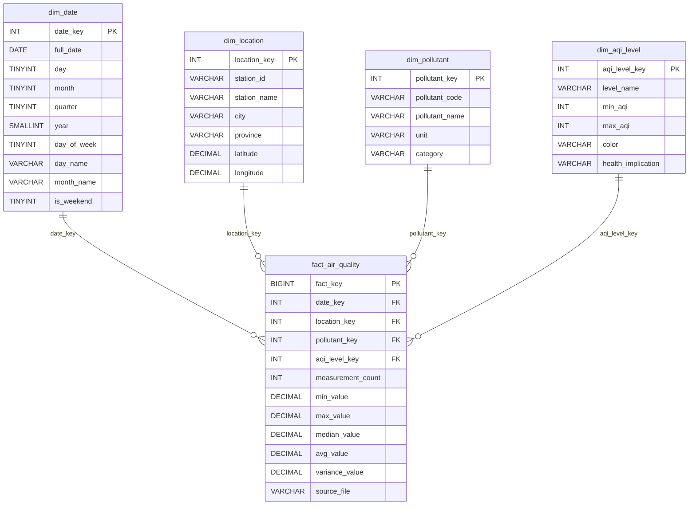
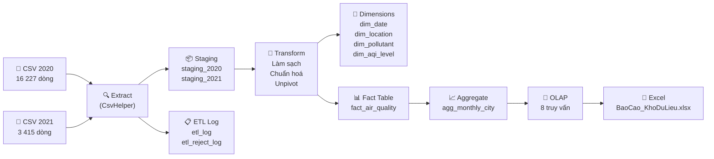

# Kho Dữ Liệu Chất Lượng Không Khí Việt Nam 2020–2021

> **Bài giữa kì môn Kho dữ liệu — Nhóm 4**

---

## Mô tả đề tài

Dự án xây dựng một **kho dữ liệu (Data Warehouse)** tích hợp dữ liệu chất lượng không khí tại Việt Nam từ hai nguồn dữ liệu khác nhau (năm 2020 và năm 2021). Hệ thống thực hiện toàn bộ quy trình ETL (Extract – Transform – Load) từ file CSV thô vào mô hình Star Schema trong cơ sở dữ liệu MySQL 8, sau đó chạy các truy vấn OLAP phân tích đa chiều và xuất báo cáo Excel.

Mục tiêu chính:
- Thu thập, làm sạch và chuẩn hóa dữ liệu AQI từ 5 thành phố lớn (2020) và ~24 trạm quan trắc tại ~10 tỉnh/thành (2021).
- Phân tích xu hướng ô nhiễm không khí theo thời gian, địa điểm và loại chất gây ô nhiễm.
- Hỗ trợ ra quyết định trong quản lý môi trường đô thị.

---

## Nguồn dữ liệu

| Năm | Tên file | Số dòng | Nguồn |
|-----|----------|---------|-------|
| 2020 | `aqi_airqualitydata_2020_en.csv` | 16 227 | Open Development Vietnam / AQICN |
| 2021 | `historical_air_quality_2021_en.csv` | 3 415 | Open Development Vietnam / AQICN |

**Trích dẫn:**
- **2020:** Open Development Vietnam (2021). *Timelines dataset on air quality in Vietnam*. Truy cập tại: https://data.opendevelopmentmekong.net/my/dataset/timelines-dataset-on-air-quality-in-vietnam
- **2021:** Open Development Vietnam (2022). *Dataset on air quality in Vietnam in 2021*. Truy cập tại: https://data.opendevelopmentmekong.net/th/dataset/dataset-on-air-quality-in-vietnam-in-2021

**Giấy phép dữ liệu:** Creative Commons Attribution 4.0 International (CC BY 4.0) — theo thông tin tại cổng Open Development Vietnam.

---

## Yêu cầu cài đặt

### Phần mềm bắt buộc

| Phần mềm | Phiên bản tối thiểu | Tải về |
|----------|--------------------|----|
| .NET SDK | 8.0 | https://dotnet.microsoft.com/download/dotnet/8.0 |
| MySQL Server | 8.0+ | https://dev.mysql.com/downloads/mysql/ |

### Gói NuGet (tự động khôi phục khi `dotnet run`)

| Gói | Mục đích |
|-----|---------|
| `MySqlConnector` | Kết nối MySQL từ .NET |
| `CsvHelper` | Đọc/phân tích file CSV |
| `ClosedXML` | Xuất báo cáo Excel (.xlsx) |

> Không cần cài thủ công — các gói được khai báo trong `src/AirQualityDW.csproj` và sẽ tự khôi phục khi chạy `dotnet run`.

---

## Cấu trúc thư mục

```
BaiTapKhoDL/
├── data/                                   # Dữ liệu nguồn CSV (Open Development Vietnam)
│   ├── aqi_airqualitydata_2020_en.csv      # 16 227 dòng, 9 cột (unpivoted)
│   └── historical_air_quality_2021_en.csv  # 3 415 dòng, 21 cột (pivoted)
│
├── sql/                                    # Mã nguồn SQL (MySQL 8, utf8mb4)
│   ├── 01_create_staging.sql               # Tạo Database, Staging tables & ETL log
│   ├── 02_create_dw.sql                    # Tạo Star Schema (Dimensions, Fact, Aggregate)
│   └── 03_olap_queries.sql                 # 8 truy vấn phân tích OLAP đa chiều
│
├── src/                                    # Toàn bộ mã nguồn ứng dụng Console .NET 8
│   ├── AirQualityDW.csproj                 # File dự án .NET 8
│   ├── Program.cs                          # Điều phối giao diện Console Menu 8 chức năng
│   ├── appsettings.json                    # Chuỗi kết nối MySQL (loại khỏi Git)
│   ├── appsettings.example.json            # File mẫu cấu hình chuỗi kết nối
│   ├── Configuration/
│   │   └── AppConfig.cs                    # Quản lý đọc cấu hình và định vị thư mục gốc
│   ├── Utilities/
│   │   └── Logger.cs                       # Tiện ích ghi log phân tầng (Console + File)
│   ├── Services/
│   │   └── DatabaseService.cs              # Kết nối ADO.NET, BulkInsert transaction
│   ├── Extract/
│   │   └── CsvExtractor.cs                 # Đọc CSV bằng CsvHelper nạp vào Staging
│   ├── Transform/
│   │   └── DataTransformer.cs              # Làm sạch, unpivot 2021, phân loại US EPA AQI
│   ├── Load/
│   │   └── DataLoader.cs                   # Nạp Dimension, Fact (idempotent), Aggregate
│   ├── Olap/
│   │   └── OlapExecutor.cs                 # Phân tích cú pháp và thực thi 8 truy vấn OLAP
│   ├── Export/
│   │   └── ExcelExporter.cs                # Xuất workbook 12 sheet bằng ClosedXML
│   └── Models/
│       ├── Staging2020Record.cs            # Model ánh xạ CSV 2020
│       ├── Staging2021Record.cs            # Model ánh xạ CSV 2021
│       └── TransformedRecord.cs            # Model dữ liệu chuẩn hóa nạp Fact
│
├── output/                                 # Thư mục lưu báo cáo kết quả
│   └── BaoCao_KhoDuLieu_ChatLuongKhongKhi.xlsx
│
├── logs/                                   # Nhật ký thực thi ETL theo thời gian
├── .gitignore                              # Quy tắc loại trừ file nhạy cảm và file build
└── README.md                               # Hướng dẫn chi tiết dự án
```

---

## Hướng dẫn chạy

### Bước 1 — Cài đặt MySQL 8 và khởi động dịch vụ

Đảm bảo dịch vụ MySQL Server 8.0+ đang chạy trên máy (mặc định cổng 3306).

```sql
-- Đăng nhập MySQL với quyền root
mysql -u root -p

-- (Tùy chọn) Kiểm tra phiên bản MySQL
SELECT VERSION();
```

> Hệ thống tự động tạo cơ sở dữ liệu `air_quality_dw` với bộ mã ký tự `utf8mb4_unicode_ci` nếu chưa tồn tại.

### Bước 2 — Cấu hình kết nối MySQL

Sao chép file mẫu `src/appsettings.example.json` thành `src/appsettings.json` (nếu chưa có) và cập nhật mật khẩu:

```json
{
  "ConnectionStrings": {
    "MySQL": "Server=localhost;Port=3306;Database=air_quality_dw;User=root;Password=MAT_KHAU_CUA_BAN;AllowLoadLocalInfile=true;CharSet=utf8mb4"
  },
  "DataPaths": {
    "File2020": "data/aqi_airqualitydata_2020_en.csv",
    "File2021": "data/historical_air_quality_2021_en.csv"
  },
  "OutputPath": "output/BaoCao_KhoDuLieu_ChatLuongKhongKhi.xlsx"
}
```

> File `appsettings.json` đã được đưa vào `.gitignore` để tránh để lộ thông tin nhạy cảm.

### Bước 3 — Đặt file CSV vào thư mục `data/`

Đảm bảo hai file CSV gốc nằm trong thư mục `data/`:
```
data/
├── aqi_airqualitydata_2020_en.csv
└── historical_air_quality_2021_en.csv
```

### Bước 4 — Khởi chạy ứng dụng

Di chuyển vào thư mục dự án C# và chạy:

```bash
cd src
dotnet run
```

Hệ thống sẽ hiển thị Menu điều khiển 8 chức năng chuẩn hóa:

```
╔════════════════════════════════════════════════════════╗
║   KHO DỮ LIỆU CHẤT LƯỢNG KHÔNG KHÍ VIỆT NAM         ║
║   Bài giữa kì môn Kho Dữ Liệu — Nhóm 4              ║
╠════════════════════════════════════════════════════════╣
║   1. Kiểm tra cấu hình và kết nối MySQL              ║
║   2. Khảo sát file CSV                                ║
║   3. Tạo staging và Data Warehouse                    ║
║   4. Chạy ETL (Extract → Transform → Load)            ║
║   5. Đối soát dữ liệu                                ║
║   6. Chạy truy vấn OLAP                              ║
║   7. Xuất báo cáo Excel                              ║
║   8. Chạy quy trình tổng thể (3 → 4 → 5 → 6 → 7)    ║
║   0. Thoát                                            ║
╚════════════════════════════════════════════════════════╝
```

### Bước 5 — Thực thi

- **Tùy chọn khuyến nghị:** Chọn `8` để tự động chạy toàn bộ quy trình từ tạo bảng, trích xuất, làm sạch, nạp kho, đối soát, truy vấn OLAP và xuất Excel.
- **Hoặc chạy từng bước:** Chọn lần lượt `1` → `2` → `3` → `4` → `5` → `6` → `7`.

### Bước 6 — Mở file báo cáo Excel

Sau khi chạy xong, mở file kết quả tại:
```
output/BaoCao_KhoDuLieu_ChatLuongKhongKhi.xlsx
```

---

## Sơ đồ Star Schema



---

## Thang AQI áp dụng

Dự án sử dụng thang đo **AQI Hoa Kỳ (US EPA)** — tiêu chuẩn được áp dụng bởi AQICN (nguồn cung cấp dữ liệu gốc).

| Mức | Tên mức | Khoảng AQI | Màu | Ý nghĩa sức khỏe |
|-----|---------|------------|-----|-----------------|
| 1 | Tốt (Good) | 0 – 50 | 🟢 Xanh lá | Chất lượng không khí tốt, ít hoặc không có nguy cơ |
| 2 | Trung bình (Moderate) | 51 – 100 | 🟡 Vàng | Chấp nhận được; một số chất có thể ảnh hưởng nhóm rất nhạy cảm |
| 3 | Không lành mạnh với nhóm nhạy cảm | 101 – 150 | 🟠 Cam | Trẻ em, người già, người có bệnh hô hấp bị ảnh hưởng |
| 4 | Không lành mạnh (Unhealthy) | 151 – 200 | 🔴 Đỏ | Mọi người bắt đầu bị ảnh hưởng; nhóm nhạy cảm bị ảnh hưởng nghiêm trọng |
| 5 | Rất không lành mạnh (Very Unhealthy) | 201 – 300 | 🟣 Tím | Cảnh báo sức khỏe; tác động đáng kể lên toàn bộ dân số |
| 6 | Nguy hiểm (Hazardous) | 301 – 500 | 🟤 Nâu đỏ | Khẩn cấp sức khỏe; toàn bộ dân số bị ảnh hưởng nghiêm trọng |

> **Nguồn:** U.S. Environmental Protection Agency — AirNow. *AQI Basics*. Truy cập tại: https://www.airnow.gov/aqi/aqi-basics/

---

## Quy trình ETL



---

## Truy vấn OLAP

Hệ thống triển khai 8 truy vấn phân tích dữ liệu đa chiều được lưu trong `sql/03_olap_queries.sql` và được chương trình C# thực thi tự động:

| # | Mã truy vấn | Tên truy vấn | Phép toán OLAP | Ý nghĩa nghiệp vụ |
|---|-------------|--------------|----------------|-------------------|
| 1 | `Q1_ROLLUP_TIME` | Roll-up theo thời gian | **Roll-up** (`WITH ROLLUP`) | Tính AQI trung bình khi cuộn lên từ Tháng → Quý → Năm trên phạm vi toàn quốc. |
| 2 | `Q2_ROLLUP_LOCATION` | Roll-up theo địa lý | **Roll-up** (`WITH ROLLUP`) | Tính AQI trung bình cuộn lên từ Thành phố → Tỉnh → Toàn quốc. |
| 3 | `Q3_DRILLDOWN_HANOI` | Drill-down tại Hà Nội | **Drill-down** (`UNION ALL`) | Xem chi tiết AQI tại Hà Nội ở 4 cấp phân giải: Năm, Quý, Tháng, và từng Ngày cụ thể. |
| 4 | `Q4_SLICE_HANOI` | Slice cố định thành phố Hà Nội | **Slice** (cố định `city = 'Hà Nội'`) | Theo dõi biến thiên AQI trung bình, nhỏ nhất, lớn nhất theo từng tháng tại Hà Nội. |
| 5 | `Q5_DICE_MULTI_DIM` | Dice lọc đồng thời đa chiều | **Dice** (năm, thành phố, chất ô nhiễm) | So sánh nồng độ bụi PM2.5 và AQI giữa Hà Nội và TP.HCM trong 2 năm 2020 và 2021. |
| 6 | `Q6_PIVOT_CITY_MONTH` | Pivot Thành phố × Tháng | **Pivot** (`CASE WHEN`) | Bảng chéo thể hiện AQI trung bình từng tháng cho các thành phố: Hà Nội, TP.HCM, Đà Nẵng, Hải Phòng. |
| 7 | `Q7_TOP_N_POLLUTED` | Top N thành phố ô nhiễm nhất | **Ranking / Top-N** | Top 5 thành phố có AQI trung bình cao nhất kèm số ngày ô nhiễm vượt ngưỡng (AQI > 100). |
| 8 | `Q8_COMPARE_2020_2021` | So sánh liên kỳ 2020 và 2021 | **So sánh liên kỳ** | Đánh giá mức độ biến thiên AQI trung bình, AQI max và số ngày vượt 100 giữa 2 năm theo địa phương. |

---

## Thành viên nhóm

| STT | Họ và tên | MSSV | Vai trò |
|-----|-----------|------|---------|
| 1 | *(Thành viên 1)* | *(MSSV)* | *(Vai trò)* |
| 2 | *(Thành viên 2)* | *(MSSV)* | *(Vai trò)* |
| 3 | *(Thành viên 3)* | *(MSSV)* | *(Vai trò)* |
| 4 | *(Thành viên 4)* | *(MSSV)* | *(Vai trò)* |

---

## Giấy phép

- **Dữ liệu:** © Open Development Vietnam — Creative Commons Attribution 4.0 International (CC BY 4.0).
- **Phần mềm:** MIT License — sử dụng cho mục đích học thuật.

```
MIT License

Copyright (c) 2024 Nhóm 4 — Môn Kho Dữ Liệu

Permission is hereby granted, free of charge, to any person obtaining a copy
of this software and associated documentation files (the "Software"), to deal
in the Software without restriction, including without limitation the rights
to use, copy, modify, merge, publish, distribute, sublicense, and/or sell
copies of the Software.
```
